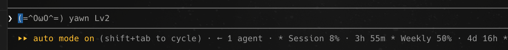

# claude-mods

Small, fun and useful mods for [Claude Code](https://claude.com/claude-code). Each one is a single command away.



| Mod | What it does |
|---|---|
| [terminal-pet](#terminal-pet) | A cat in the empty prompt box that reacts to your day, with next-step suggestions beside it, plus `/pet-stats` silly stats |
| [usage-band](#usage-band) | Your session and weekly plan usage as gauges in a bar above the prompt |
| [ringtones](#ringtones) | Short synthesized chimes for finished turns, blocked calls, failures and shipping |
| [cross-fire](#cross-fire) | Holds destructive shell commands for your confirmation and says what they would hit |
| [security-guard](#security-guard) | Checks commits and PRs against the rules in your own and the project's CLAUDE.md |
| [session-resume](#session-resume) | Sends "continue" when a rate-limit window resets after a limit stopped your turn |
| [erp-log-nudge](#erp-log-nudge) | Reminds you late on weekdays to log ERP time when today is still empty |
| [render-md](#render-md) | Renders Markdown files Claude edits in a side pane |

## Install

Type this at the prompt of a Claude Code terminal session:

```
/plugin install terminal-pet --marketplace UsamaSadiq/claude-mods
```

```
/plugin install usage-band --marketplace UsamaSadiq/claude-mods
```

The other mods install the same way: `ringtones`, `cross-fire`, `security-guard`, `session-resume`, `erp-log-nudge` and `render-md`.

The first install asks to add the `UsamaSadiq/claude-mods` marketplace (answer `y`) and which scope to install into. The mod is active right away, with no restart.

To remove one: `/plugin uninstall <mod>`.

## terminal-pet

A cat lives in your empty prompt box and reacts to what's happening:

| Mood | Cat | When |
|---|---|---|
| playing | `ฅ^•ﻌ•^ฅ~ playing` | for 3 minutes after a successful `git push` or `gh pr merge` |
| hissing | `(=ↀДↀ=) hiss!` | for 2 minutes after a tool call is blocked |
| sleeping | `(=-ω-=) zzz` | 11pm to 6am |
| yawning | `(=^OωO^=) yawn` | 9pm to 11pm |
| stretching | `/ᐠ - ˕ -マ stretch?` | after 2 hours of prompting without a 15-minute break |
| eager | `/ᐠ｡ꞈ｡ᐟ\ eager` | you sent a prompt in the last 10 minutes |
| resting | `ᓚᘏᗢ resting` | otherwise |

The first matching row wins. Times are your machine's local time.

**Levels.** Commits earn 1 XP, pushes 2 and merged PRs 5. XP adds up across sessions and days. The cat earns a star at Lv3 and a crown at Lv6:

```
♔ᓚᘏᗢ resting Lv7
```

**Suggestions.** When Claude suggests your next prompt, the cat sits in front of it:

```
ᓚᘏᗢ resting Lv3  run the tests
```

Accepting the suggestion sends only the suggestion. If you accidentally submit the cat alone, it's dropped and nothing is sent.

**Next steps.** After each answer, up to three short follow-up prompts appear in a band above the box, with the cat still in the box. Click one, or press ctrl+x then Tab to focus the band and then `1`, `2` or `3`, to put it in the box, then edit it or press Enter. They are written by a small model call (`haiku`), dropped when you type, and skipped after an interrupted or failed turn. Turn them off with the `nextSteps` setting.

**Silly stats.** Type `/pet-stats` for today's numbers across all your sessions:

```
ᓚᘏᗢ resting Lv3  Today's silly stats
· You typed 2,341 words to Claude, about a short story.
· You said "continue" 14 times and "please" 3 times.
· Claude ran 96 tools and edited 12 files.
· 3 commits, 2 pushes, 1 PR merged.
· Blocked 2 times. Nice try.
· Longest turn: 23m, long enough to boil 2 eggs.
· Pet: Lv3, 42 XP.
```

The same report pops up once a day after the report hour.

**Settings** (in `/config`, or asked for at install):

| Setting | Default | Meaning |
|---|---|---|
| `reportHour` | `18` | Local hour after which the daily report pops up once. `-1` turns it off. |
| `nextSteps` | `true` | Show follow-up suggestions above the box after each answer. |
| `stepCount` | `3` | How many suggestions, 1 to 3. |

## usage-band

Draws your plan usage as a bar above the prompt, with time left until each window resets. The hint line under the prompt is left alone:

```
Session ▰▱▱▱▱▱▱▱ 12% · 4h 2m   Weekly ▰▰▰▱▱▱▱▱ 43% · 4d 21h
```

Each gauge has eight cells and turns yellow from 70% and red from 90%. It refreshes every minute, and straight away whenever Claude Code reports new rate-limit figures. Until the first reading arrives it shows `Usage: waiting for the first reading`. It steps aside for a survey, and it stacks with terminal-pet's next-step suggestions rather than replacing them.

## ringtones

Four short chimes, synthesized for this repo, play on:

| Sound | When |
|---|---|
| done | a main-loop turn that took at least 20 seconds ends with an answer |
| ship | a `git push` or `gh pr merge` succeeds |
| blocked | a tool call is denied |
| oops | a turn ends in an error |

Sounds are debounced to one per 1.5 seconds. Playback uses `afplay`, so it is silent off macOS.

| Setting | Default | Meaning |
|---|---|---|
| `isMuted` | `false` | Silence every chime |
| `volume` | `0.6` | Linear gain, 0 to 4 |
| `minTurnSeconds` | `20` | Shortest turn that plays the done chime |

## cross-fire

Puts a confirmation in front of Bash commands that are hard to undo, with one line on what each would hit:

```
cross-fire held a force push: it rewrites the remote branch history for everyone who pulled it.
```

Held: recursive `rm` (except disposable directories such as `node_modules`, `dist`, `.venv`), `git push --force` / `-f` (not `--force-with-lease`), `git reset --hard`, `git clean -f`, `git branch -D`, `git checkout -- .`, `DROP` / `TRUNCATE`, migrations, `dd of=`, `mkfs` and recursive `chmod` / `chown`.

It answers `ask` at `tool.check`, so the usual permission dialog appears. Modes that decide asks without you (`bypassPermissions`, and `auto`, where a classifier answers) may let a held command through without the question reaching you; a mod cannot read the mode to tell.

## security-guard

Holds every `git commit`, `gh pr create` and `gh pr edit` up against your own written rules, and refuses the ones that break them with a reason Claude can act on.

It reads, when present:

- `~/.claude/CLAUDE.md`
- `<project>/CLAUDE.md`
- `<project>/.claude/CLAUDE.md`
- `<project>/CLAUDE.local.md`

A small model (haiku) judges the command against the rules about commits and pull requests in those files, and the project's rule wins where they disagree. It runs only on those three commands, never on other Bash calls. With no rules found it does nothing. If the judge is unavailable or its reply is unreadable, the command goes through. There are no settings: change the rules, and the guard follows.

## session-resume

When a turn ends in an error while a rate-limit window reads 100%, it waits for the reset and then sends `continue`:

```
session-resume: limit reached. Will send "continue" in 1h 01m. Type anything to cancel.
```

Typing a prompt, or `/session-resume cancel`, cancels it. `/session-resume` shows the countdown. It survives a mod reload, and it does not wait for windows that reset later than `maxWaitHours` (a weekly limit, say).

| Setting | Default | Meaning |
|---|---|---|
| `message` | `continue` | The prompt sent on reset |
| `bufferSeconds` | `45` | Wait past the reset time |
| `maxWaitHours` | `6` | Longest wait it will accept |

## erp-log-nudge

After `nudgeHour` on a weekday, once a day, it asks the ERP connector whether today has any time logged, and if not it shows a toast pointing at `/generate-erp-logs`. If the connector cannot be reached it still nudges, worded as unchecked. `/erp-nudge` checks on demand.

| Setting | Default | Meaning |
|---|---|---|
| `nudgeHour` | `20` | Local hour after which to nudge. `-1` turns it off |
| `server` | `claude_ai_ERP_MCP` | The connector's name, as `/mcp` lists it or in tool-name spelling |
| `skill` | `/generate-erp-logs` | The command the nudge points at |

## render-md

When Claude writes or edits a `.md`, `.markdown` or `.mdx` file, a pane renders it. The pane keeps tabs for the last five files. `/render-md <file>` opens any Markdown file.

| Setting | Default | Meaning |
|---|---|---|
| `autoOpen` | `true` | Open the pane by itself on an edit |

A pane opened by an edit needs a terminal at least 144 columns wide, and below that it waits undrawn until you run `/render-md`. In fullscreen it docks beside the transcript; on the main screen it opens inline above the prompt. Set `autoOpen` to `false` to only open it yourself.

## Using them together

Both mods are built to share the screen. usage-band and terminal-pet's next steps both draw above the prompt and stack in one column, and terminal-pet uses the prompt box, so neither overwrites the other.

## Developing

Each mod lives in `plugins/<name>/`: a `.claude-plugin/plugin.json` manifest, a hooks module in `hooks/`, its state types in `types/` and tests in `tests/`.

```
claude --plugin-dir plugins/terminal-pet   # run a session with your working copy
claude plugin validate plugins/terminal-pet
claude plugin test plugins/terminal-pet
```

CI runs validate and test for every mod on each push and pull request.

## License

[MIT](LICENSE)
